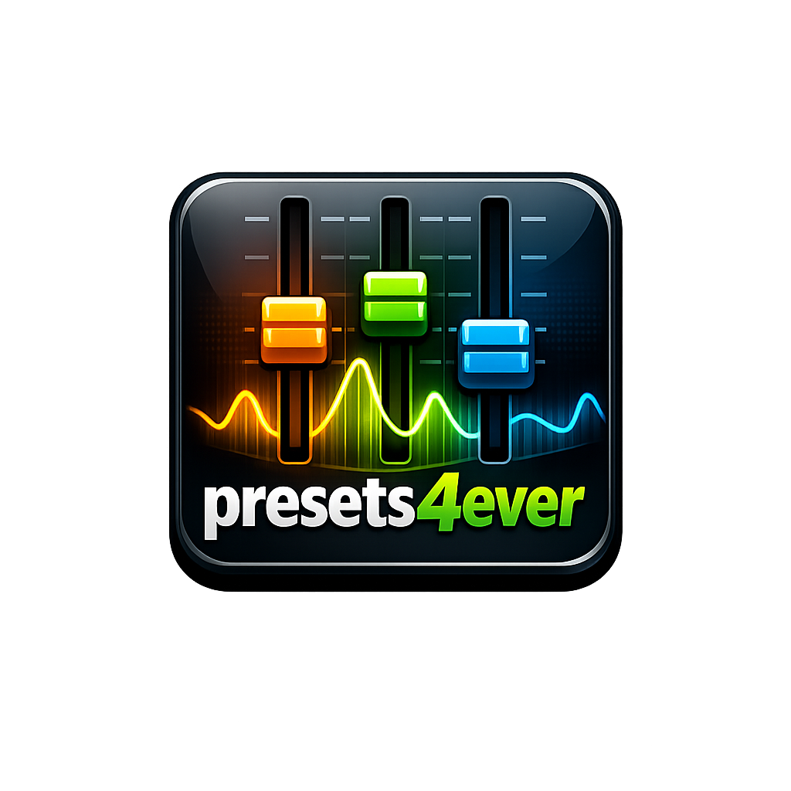

<div align="center">
   
  
  # 🎛️ Presets4Ever
  
  **Comunidade de Produção Musical**
  
  [](https://nextjs.org/)
  [](https://www.javascript.com/)
  [](https://tailwindcss.com/)
  [](LICENSE)
</div>

---

## 🧭 Conteúdo

- [Visão Geral](#visão-geral)
- [Tecnologias](#tecnologias)
- [Recursos Principais](#recursos-principais)
- [Instalação](#instalação)

---

## 📖 Visão Geral

**Presets4Ever** é a plataforma definitiva para produtores musicais compartilharem e descobrirem recursos essenciais de produção. Nossa comunidade global se une para trocar **Presets**, **VSTs** e **Drumkits** de forma gratuita, organizada e colaborativa.

## 🛠️ Tecnologias

<div align="center">

|                                         **Framework Principal**                                          |                                            **Estilização e UI**                                            |                                        **Backend e Dados**                                         |
| :------------------------------------------------------------------------------------------------------: | :--------------------------------------------------------------------------------------------------------: | :------------------------------------------------------------------------------------------------: |
|                         |  |  |
|  |                                                                                                            |                         |
|              |                                                                                                            |                                                                                                    |

</div>

---

## 🎼 Recursos Principais

### 🔍 Descoberta e Busca

<table>
  <tr>
    <th width="30%">Recurso</th>
    <th width="70%">Descrição</th>
  </tr>
  <tr>
    <td><strong>🔥 Tendências</strong></td>
    <td>Descubra os presets, VSTs e drumkits mais baixados e melhor avaliados pela comunidade</td>
  </tr>
  <tr>
    <td><strong>🔍 Busca Avançada</strong></td>
    <td>Busca inteligente por DAW (Ableton, FL Studio, Logic), plugin (Serum, Vital, Omnisphere), gênero e BPM</td>
  </tr>
  <tr>
    <td><strong>🏷️ Tags Inteligentes</strong></td>
    <td>Organização por categorias: Trap, EDM, Lo-Fi, House, Techno, Boom Bap, Drill e mais</td>
  </tr>
  
  <tr>
    <td><strong>🎛️ Filtro por Tipo</strong></td>
    <td>Filtre por Presets (synth, FX), VSTs (instrumentos, efeitos) ou Drumkits (808s, caixas, hi-hats)</td>
  </tr>
</table>

---

## 💻 Instalação

### 📋 Requisitos do Sistema

| Componente                 | Requisito Mínimo        |
| -------------------------- | ----------------------- |
| **Node.js**                | Versão 18.0 ou superior |
| **Gerenciador de Pacotes** | NPM                     |
| **Banco de Dados**         | Supabase                |
| **SO**                     | Windows, macOS ou Linux |

### 🚀 Guia de Início Rápido

#### 1️⃣ Clone o repositório

```bash
git clone https://github.com/kiuzo/presets4ever.git
cd presets4ever
```

#### 2️⃣ Instale as dependências

```bash
npm install

```

#### 3️⃣ Configure as Variáveis de Ambiente

Crie um arquivo `.env.local` no diretório raiz:

```env
# Configuração do Supabase
NEXT_PUBLIC_SUPABASE_URL=sua_url_do_projeto.supabase.co
NEXT_PUBLIC_SUPABASE_ANON_KEY=sua_chave_anon_aqui
```

#### 4️⃣ Inicie o Servidor de Desenvolvimento

```bash
npm run dev
```

🎉 Acesse a aplicação em: **http://localhost:3000**

### 📦 Build para Produção

```bash
npm run build
npm run dev
```

---

<div align="center">

## 👨‍💻 Criado Por

<table>
  <tr>
    <td align="center">
      <a href="https://github.com/kiuzo">
        
        <br />
        <sub><b>Kiuzo</b></sub>
      </a>
      <br />
      <sub>Desenvolvedor Full Stack</sub>
      <br />
      <a href="https://www.linkedin.com/in/david-soares-lopes/">💼 LinkedIn</a>
    </td>
  </tr>
</table>

---

**© 2025 Projeto Presets4Ever**

Feito com ❤️ por produtores, para produtores

[](https://kiuzo.vercel.app)
[](https://github.com/kiuzo)

</div>
